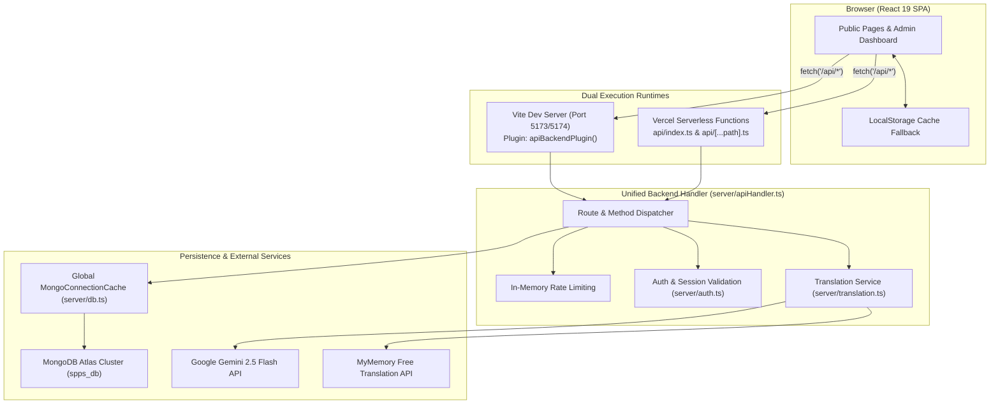
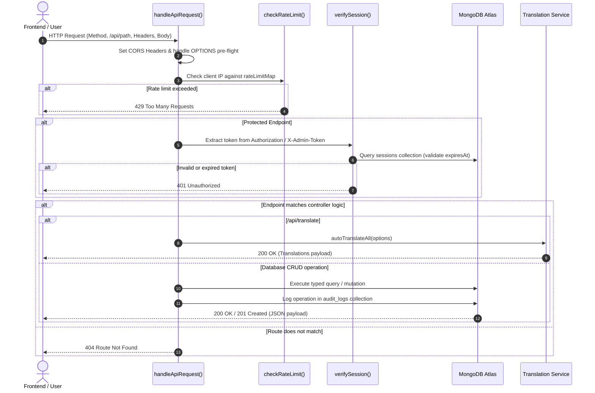
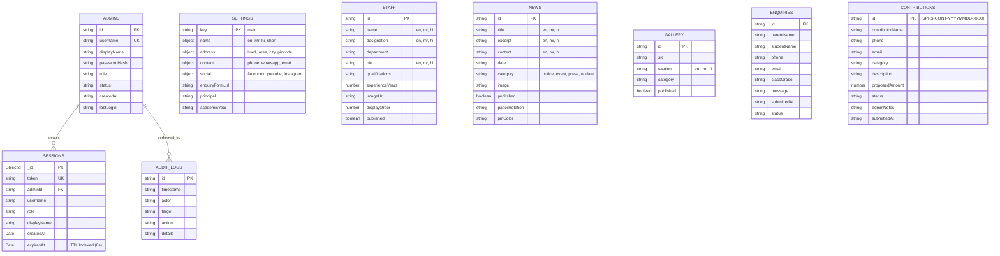
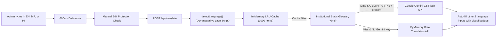

# P.M. Shri Savitribai Phule High School — Internal Developer Handbook & Technical Documentation

> **Document Type:** Personal Developer Handbook & Project Technical Architecture Manual  
> **Target Audience:** Primary Author / Lead Developer (Self-Reference for Maintenance, Debugging, Expansion, and Redeployment after 6–12+ months)  
> **Institution:** P.M. Shri Savitribai Phule High School, Municipal Corporation, Chandrapur (पी.एम. श्री. सावित्रीबाई फुले हायस्कूल, महानगरपालिका, चंद्रपूर)  
> **Workspace Root:** `D:\spps`  
> **Status:** Production-Ready (Verified on React 19.3.1 + Vite 8.3.5 + MongoDB Native Driver 7.7.0 + Node.js 20+)

---

## Table of Contents

1. [Project Overview & Institutional Background](#1-project-overview--institutional-background)
2. [Technology Stack & Dependency Blueprint](#2-technology-stack--dependency-blueprint)
3. [System Architecture & Dual-Runtime Execution](#3-system-architecture--dual-runtime-execution)
4. [Complete Project Folder Structure & File Responsibilities](#4-complete-project-folder-structure--file-responsibilities)
5. [Frontend Architecture & UI Engineering](#5-frontend-architecture--ui-engineering)
6. [Backend Architecture & API Reference](#6-backend-architecture--api-reference)
7. [MongoDB Database Architecture](#7-mongodb-database-architecture)
8. [Admin Panel Engineering](#8-admin-panel-engineering)
9. [Multilingual Auto-Translation System](#9-multilingual-auto-translation-system)
10. [Image & Static Asset Management](#10-image--static-asset-management)
11. [Environment Variables Reference](#11-environment-variables-reference)
12. [Installation & Local Development Setup](#12-installation--local-development-setup)
13. [Build, Verification & Automated Testing](#13-build-verification--automated-testing)
14. [Deployment Guide & Production Workflow (Vercel)](#14-deployment-guide--production-workflow-vercel)
15. [Common Maintenance Tasks (Step-by-Step Cookbook)](#15-common-maintenance-tasks-step-by-step-cookbook)
16. [Troubleshooting & Diagnostic Playbook](#16-troubleshooting--diagnostic-playbook)
17. [Security Analysis & Hardening Recommendations](#17-security-analysis--hardening-recommendations)
18. [Important Technical Decisions & Architectural Rationale](#18-important-technical-decisions--architectural-rationale)
19. [Known Limitations & Technical Debt](#19-known-limitations--technical-debt)
20. [Future Maintenance Checklist (6–12 Month Return)](#20-future-maintenance-checklist-612-month-return)

---

## 1. Project Overview & Institutional Background

### 1.1 Purpose & Institutional Identity
This project is the official web portal, administrative management suite, and digital public archive for **P.M. Shri Savitribai Phule High School**, located at Netaji Chowk, Babupeth, Chandrapur, Maharashtra (Pincode: 442403). The school is administered by the **Chandrapur Municipal Corporation (मनपा - Chandrapur Mahanagarpalika)** and operates under the central government's prestigious **PM SHRI (Prime Minister Schools for Rising India)** scheme.

The portal serves three distinct user cohorts:
1. **Public Visitors, Parents & Community:** Prospective parents looking for admission circulars, academic details, faculty profiles, co-curricular achievements, facilities overview, and transparent community contribution opportunities.
2. **Students & Alumni:** Accessing examination circulars, news bulletins, holiday notices, cultural event photography, and institutional archives.
3. **School Administrative Staff & Headmasters:** Managing public notices, bulletin boards, faculty dossiers, gallery assets, school contact metadata, and community donor enquiries through a secured administrative dashboard.

### 1.2 Design Philosophy: Editorial Heritage & Authentic Storytelling
Unlike generic school websites featuring stock photography and blue-tinted corporate templates, this project follows an **editorial publication aesthetic**:
- **Palette:** Deep forest green (`#07190f`, `#0d2818`, `#143d24`), warm ivory/parchment (`#fdfcf9`, `#f7f4ee`, `#ebe5d8`), and antique saffron/gold accents (`#cf9d38`, `#b8860b`).
- **Typography:** High-contrast editorial serif headings (`Playfair Display` / `Georgia`) paired with ultra-legible modern sans-serif body copy (`Plus Jakarta Sans` / system font stack).
- **Authenticity:** 100% of photographic assets were systematically extracted and cataloged from the school's actual institutional presentations (`Presentation 2026-27.pptx` and `Upkram 1.pptx`), depicting actual classrooms, science exhibitions, eco-club initiatives, and municipal faculty.

---

## 2. Technology Stack & Dependency Blueprint

### 2.1 Core Runtime & Frameworks
| Layer | Technology | Exact Version | Purpose & Location |
|---|---|---|---|
| **UI Library** | React | `^19.3.1` | Client-side reactive rendering, hooks, and context (`src/`) |
| **DOM Engine** | React DOM | `^19.3.1` | Root mounting and virtual DOM reconciliation (`src/main.tsx`) |
| **Language** | TypeScript | `~7.0.2` | Strict end-to-end type safety (`tsconfig.json`, `tsconfig.app.json`) |
| **Bundler & Dev Server** | Vite | `^8.3.5` | Fast HMR, Rollup production bundling, dev server middleware (`vite.config.ts`) |
| **Client Routing** | React Router DOM | `^7.18.5` | Declarative SPA routing, nested routes, and location tracking (`src/App.tsx`) |
| **Database Driver** | MongoDB Native Driver | `^7.7.0` | Official high-performance MongoDB driver with connection pooling (`server/db.ts`) |
| **Cryptography** | Node.js `node:crypto` | Built-in | Cryptographic `scryptSync` password hashing and secure token generation (`server/auth.ts`) |
| **Iconography** | Lucide React | `^1.64.0` | Lightweight SVG icon system across frontend and admin panel |
| **Linter** | Oxlint | `^1.89.0` | High-speed Rust-based JavaScript/TypeScript linter (`.oxlintrc.json`) |
| **Testing Utility** | MongoDB Memory Server | `^11.3.0` | In-memory MongoDB testing environment (`scripts/test-mongodb.ts`) |

### 2.2 External APIs & Integrations
1. **Google Gemini API (`gemini-2.5-flash`):** Optional high-fidelity contextual translation engine for English ↔ Marathi ↔ Hindi (`server/translation.ts`). Enabled via `GEMINI_API_KEY`.
2. **MyMemory Translation API:** Zero-configuration fallback translation provider when no Gemini API key is configured.
3. **MongoDB Atlas:** Hosted MongoDB database cluster providing data persistence across serverless executions.

---

## 3. System Architecture & Dual-Runtime Execution

The application is engineered using a **Unified Shared Backend Architecture**. The exact same API routing and business logic (`server/apiHandler.ts`) runs identically in both local development and Vercel serverless production without code duplication.



### 3.1 Development Runtime (Vite Middleware)
- Defined in [`vite.config.ts`](file:///d:/spps/vite.config.ts) through `apiBackendPlugin()`.
- Hooks directly into Vite's internal Connect middleware pipeline via `server.middlewares.use(...)`.
- Any request starting with `/api` is intercepted before Vite serves static files and forwarded to `handleApiRequest(req, res)` from `server/apiHandler.ts`.
- Environment variables from `.env` are injected into `process.env` dynamically by `loadEnv()`.

### 3.2 Production Runtime (Vercel Serverless)
- Defined in [`vercel.json`](file:///d:/spps/vercel.json) using edge rewrites:
  - `/api/(.*)` rewrites to `/api/index`.
  - `/((?!api/).*)` rewrites to `/index.html` (enabling client-side HTML5 PushState routing).
- [`api/index.ts`](file:///d:/spps/api/index.ts) and [`api/[...path].ts`](file:///d:/spps/api/[...path].ts) act as lightweight entry wrappers conforming to Vercel's Node.js Serverless Function signature (`IncomingMessage`, `ServerResponse`).
- They immediately delegate execution to `handleApiRequest(req, res)`.
- Database connections are cached globally across lambda invocations using `global._mongoConnectionCache` in `server/db.ts`.

---

## 4. Complete Project Folder Structure & File Responsibilities

```
D:\spps\
├── .env                              # Local environment variables (DO NOT COMMIT)
├── .env.example                      # Template for environment variables with documentation
├── .gitignore                        # Git exclusion rules (node_modules, dist, .env)
├── .oxlintrc.json                    # Configuration for Oxlint fast code linter
├── index.html                        # Application HTML entry point with fonts & meta tags
├── package.json                      # Project manifest, dependencies, and npm scripts
├── package-lock.json                 # Pinned dependency tree
├── README.md                         # This internal technical documentation handbook
├── Todo                              # Historical developer notes and scratchpad
├── tsconfig.json                     # Base TypeScript configuration
├── tsconfig.app.json                 # Client-side React TypeScript rules
├── tsconfig.node.json                # Node-side TypeScript rules (Vite, server scripts)
├── vercel.json                       # Vercel deployment rewrites for SPA & Serverless APIs
├── vite.config.ts                    # Vite configuration & dev server API middleware plugin
│
├── api/                              # Vercel Serverless Function entry points
│   ├── index.ts                      # Main handler mapping /api requests to handleApiRequest()
│   └── [...path].ts                  # Catch-all wildcard handler for nested API subpaths
│
├── data/                             # Initial JSON seed datasets & recovery backups
│   ├── admins.json                   # Initial Super Administrator seed definition
│   ├── audit.json                    # Historical seed audit log entries
│   ├── gallery.json                  # Fallback gallery data
│   ├── news.json                     # Initial news items & circulars
│   └── settings.json                 # Initial school contact and institutional metadata
│
├── docs/                             # Original source materials & extraction toolchain
│   ├── Presentation 2026-27.pptx     # Source presentation 1 (Academic, PM Shri, Infrastructure)
│   ├── Upkram 1.pptx                 # Source presentation 2 (Activities, Trips, Clubs)
│   ├── contact_sheet.html            # HTML image contact sheet generated during audit
│   ├── generate_contact_sheet.py     # Python script to audit extracted presentation images
│   ├── inspect_slides.py             # Python script extracting text from presentation slides
│   ├── pptx1_extracted/              # Unpacked slide XML and raw embedded images
│   └── pptx2_extracted/              # Unpacked slide XML and raw embedded images
│
├── public/                           # Static public assets served directly by web server
│   ├── favicon.ico / .png / .svg     # School crest favicons
│   ├── icons.svg                     # SVG sprite sheet
│   └── assets/images/                # Verified public photographic assets
│       ├── savitribai-logo.jpg       # Official portrait of Krantijyoti Savitribai Phule
│       ├── pptx1/                    # 63 optimized photos extracted from Presentation 2026-27
│       └── pptx2/                    # 64 optimized photos extracted from Upkram 1
│
├── scripts/                          # Automated developer utility scripts
│   └── test-mongodb.ts               # Standalone test runner with MongoMemoryServer
│
├── server/                           # Backend serverless & middleware implementation
│   ├── apiHandler.ts                 # Central REST API router, request parsers & controllers
│   ├── auth.ts                       # scrypt password hashing, session tokens & audit logs
│   ├── db.ts                         # MongoDB Atlas connection manager & typed collections
│   ├── seed.ts                       # Automated database seeder on initial startup
│   ├── translation.ts                # Multilingual translation engine (Glossary/Gemini/MyMemory)
│   └── types.ts                      # TypeScript interfaces for database documents & models
│
└── src/                              # Frontend React application source code
    ├── main.tsx                      # React root rendering entry point
    ├── App.tsx                       # Top-level router definition, route guards & providers
    ├── App.css                       # Application-level structural helpers
    ├── index.css                     # Design system tokens, typography & CSS variables
    │
    ├── assets/                       # Bundled static module assets
    │   └── logo.jpg                  # Bundled school crest asset
    │
    ├── components/                   # Shared presentation components
    │   ├── Header.tsx / .css         # Editorial 7-link responsive header with mobile drawer
    │   ├── Footer.tsx / .css         # Institutional footer with links, map & accreditation
    │   ├── Layout.tsx                # Public wrapper with scroll-to-top & header/footer
    │   └── admin/                    # Admin-specific reusable widgets
    │       ├── MultilingualField.tsx # 3-language auto-translating debounced input component
    │       └── MultilingualField.css # Styling and badges for multilingual fields
    │
    ├── config/                       # Client configuration
    │   └── school.ts                 # Default fallback school details, contact info & addresses
    │
    ├── context/                      # React context providers
    │   └── SchoolSettingsContext.tsx # Global state syncing school settings from /api/settings
    │
    ├── data/                         # Static datasets & semantic manifests
    │   ├── gallery.ts                # Default 62 static curated gallery photographs
    │   ├── imageManifest.ts          # Semantic catalog of all 127 presentation images
    │   └── news.ts                   # Default fallback news bulletins and press clippings
    │
    ├── hooks/                        # Custom React hooks
    │   └── useScrollReveal.ts        # IntersectionObserver hook for subtle entrance animations
    │
    ├── i18n/                         # Internationalization framework
    │   ├── index.tsx                 # I18nProvider, language switcher hook, localStorage sync
    │   ├── en.ts                     # English UI dictionary
    │   ├── mr.ts                     # Marathi (मराठी) UI dictionary (Primary Language)
    │   └── hi.ts                     # Hindi (हिंदी) UI dictionary
    │
    ├── pages/                        # Public route views
    │   ├── Home.tsx / .css           # Editorial homepage (10 asymmetrical narrative sections)
    │   ├── About.tsx / .css          # School legacy, Municipal Corporation link, leadership
    │   ├── Academics.tsx / .css      # FLN, curriculum, evaluation, NEP 2020 framework
    │   ├── Facilities.tsx / .css     # Smart classrooms, computer labs, library, playground
    │   ├── Activities.tsx / .css     # Eco club, science clubs, educational study tours
    │   ├── TeachingStaff.tsx / .css  # Public faculty listing with department filtering
    │   ├── Contribution.tsx / .css   # Community & alumni donation submission workflow
    │   ├── News.tsx / .css           # Realistic pin-board notice board & press clipping archive
    │   ├── Gallery.tsx / .css        # Asymmetric photographic archive with category filtering
    │   ├── Contact.tsx / .css        # Contact details, Google Map embed & admission enquiry form
    │   └── admin/                    # Secured Admin Dashboard views
    │       ├── AdminLogin.tsx / .css # Secured administrative authentication portal
    │       ├── AdminDashboard.tsx    # Multi-tab administration management control center
    │       ├── AdminDashboard.css    # Responsive dashboard styling
    │       ├── AdminAccounts.css     # Admin account management table styles
    │       ├── StaffManagementTab.tsx# Teaching faculty CRUD with photo upload & order controls
    │       └── ContributionManagementTab.tsx # Donor enquiry workflow tracking & review
    │
    └── utils/                        # Frontend API clients and helper routines
        └── api.ts                    # Typed client fetching functions for all backend routes
```

---

## 5. Frontend Architecture & UI Engineering

### 5.1 Application Entry & Provider Hierarchy
Rendering starts in [`src/main.tsx`](file:///d:/spps/src/main.tsx) using `React 19`'s `createRoot` and `StrictMode`. The component tree in [`src/App.tsx`](file:///d:/spps/src/App.tsx) wraps the entire application in two cascading context providers:

```
<StrictMode>
  <I18nProvider>                     # Provides lang ("mr" | "en" | "hi"), setLang, and dictionary t
    <SchoolSettingsProvider>         # Syncs live institutional data from /api/settings into memory
      <BrowserRouter>                # HTML5 PushState routing via React Router DOM v7
        <Routes>
          <Route element={<Layout />}># Public shell: Header, Skip-Link, Outlet, Scroll-Reset, Footer
            <Route path="/" ... />
            ... (10 Public Routes)
          </Route>
          <Route path="/admin/*" ...># Standalone Admin shell (Login & Dashboard without public Layout)
        </Routes>
      </BrowserRouter>
    </SchoolSettingsProvider>
  </I18nProvider>
</StrictMode>
```

### 5.2 Public Navigation System
The public navigation is explicitly restricted to **seven top-level destinations** in [`src/components/Header.tsx`](file:///d:/spps/src/components/Header.tsx):
1. **Home** (`/`)
2. **About Us** (`/about`)
3. **Teaching Staff** (`/teaching-staff`)
4. **Facilities** (`/facilities`)
5. **Contribution** (`/contribution`)
6. **News & Notices** (`/news`)
7. **Gallery** (`/gallery`)

*Note:* Additional pages like `/academics`, `/activities`, and `/contact` remain fully functional and routed, but are intentionally linked through contextual CTA buttons, editorial callouts, and the site footer to maintain an uncluttered top navigation bar.

### 5.3 Design System & CSS Architecture
Styling is organized entirely through native CSS variables in [`src/index.css`](file:///d:/spps/src/index.css) without CSS-in-JS runtime overhead:
- **Root Elevation & Palette Tokens:**
  - `--clr-forest-950`: `#07190f` (Deepest forest green base)
  - `--clr-forest-900`: `#0d2818` (Primary brand container dark)
  - `--clr-forest-800`: `#143d24` (Interactive hover green)
  - `--clr-parchment-50`: `#fdfcf9` (Primary background warm ivory)
  - `--clr-parchment-100`: `#f7f4ee` (Subtle container surface)
  - `--clr-gold-accent`: `#cf9d38` (Accreditation & brass plate highlight)
  - `--clr-saffron-500`: `#e07a1e` (Muted saffron ceremonial accent)
- **Fluid Typography:** Uses CSS `clamp()` for responsive headlines (e.g. `clamp(2.2rem, 4vw, 3.5rem)`), ensuring flawless legibility from 320px mobile phones up to 4K ultra-wide monitors without breakpoint snapping.
- **Scrollbar Architecture:** Global horizontal scrolling is strictly suppressed on `html` and `body` (`overflow-x: hidden`). Internal page containers (`.home-editorial`, `.news-section`) avoid `overflow-x: hidden` to prevent browsers from implicitly calculating `overflow-y: auto`, which previously caused duplicate scrollbars.

---

## 6. Backend Architecture & API Reference

### 6.1 Request Lifecycle
Every API request adheres to the following unified processing sequence in [`server/apiHandler.ts`](file:///d:/spps/server/apiHandler.ts):



### 6.2 Complete API Reference Table
All 36 endpoints implemented in [`server/apiHandler.ts`](file:///d:/spps/server/apiHandler.ts) are documented below:

| Endpoint | Method | Purpose | Authentication | Related File |
|---|---|---|---|---|
| `/api/health` | `GET` | System health check, DB ping, and collection statistics | Public | `server/apiHandler.ts` |
| `/api/translate` | `POST` | Bidirectional auto-translation between EN, MR, and HI | Admin Token | `server/translation.ts` |
| `/api/auth/login` | `POST` | Authenticate admin via scrypt hash, issue 24h session token | Public (Rate-limited: 5/min) | `server/auth.ts` |
| `/api/auth/me` | `GET` | Validate session token, return sanitized admin identity | Admin Token | `server/auth.ts` |
| `/api/auth/logout` | `POST` | Invalidate and delete active session token from MongoDB | Admin Token | `server/auth.ts` |
| `/api/admin/stats` | `GET` | Aggregate counters and metrics for the admin dashboard | Admin Token | `server/apiHandler.ts` |
| `/api/admin/profile` | `PUT` | Update logged-in admin username or display name | Admin Token | `server/apiHandler.ts` |
| `/api/admin/change-password` | `POST` | Verify current password and update with new scrypt hash | Admin Token | `server/auth.ts` |
| `/api/admin/accounts` | `GET` | List all administrator accounts (sanitized) | Super Admin Only | `server/apiHandler.ts` |
| `/api/admin/accounts` | `POST` | Create a new administrator account | Super Admin Only | `server/auth.ts` |
| `/api/admin/accounts/:id` | `PUT` | Update admin role, status, displayName, or password | Super Admin Only | `server/auth.ts` |
| `/api/admin/accounts/:id` | `DELETE`| Remove administrator account (with self-delete guard) | Super Admin Only | `server/apiHandler.ts` |
| `/api/admin/audit-logs` | `GET` | Retrieve latest 200 operational audit log entries | Super Admin Only | `server/auth.ts` |
| `/api/admin/audit-logs` | `DELETE`| Clear all historical audit logs | Super Admin Only | `server/auth.ts` |
| `/api/settings` | `GET` | Retrieve institutional configuration, addresses, contacts | Public | `server/apiHandler.ts` |
| `/api/settings` | `POST` | Upsert institutional configuration and contact info | Admin Token | `server/apiHandler.ts` |
| `/api/news` | `GET` | Fetch news bulletins and circulars (filters published) | Public (Admin sees all) | `server/apiHandler.ts` |
| `/api/news` | `POST` | Bulk save/replace news items and notices | Admin Token | `server/apiHandler.ts` |
| `/api/news/:id` | `PUT` | Update a specific news item by ID | Admin Token | `server/apiHandler.ts` |
| `/api/news/:id` | `DELETE`| Delete a specific news item by ID | Admin Token | `server/apiHandler.ts` |
| `/api/gallery` | `GET` | Fetch gallery photograph items | Public (Admin sees all) | `server/apiHandler.ts` |
| `/api/gallery` | `POST` | Bulk save/replace gallery photograph items | Admin Token | `server/apiHandler.ts` |
| `/api/gallery/:id` | `PUT` | Update a specific gallery photograph by ID | Admin Token | `server/apiHandler.ts` |
| `/api/gallery/:id` | `DELETE`| Delete a gallery photograph by ID | Admin Token | `server/apiHandler.ts` |
| `/api/enquiries` | `POST` | Submit parent admission/general enquiry from Contact page | Public (Rate-limited: 10/min) | `server/apiHandler.ts` |
| `/api/admin/enquiries` | `GET` | List all submitted admission enquiries | Admin Token | `server/apiHandler.ts` |
| `/api/admin/enquiries/:id` | `DELETE`| Delete an admission enquiry record by ID | Admin Token | `server/apiHandler.ts` |
| `/api/staff` | `GET` | Fetch public list of teaching staff (`published: true`) | Public | `server/apiHandler.ts` |
| `/api/admin/staff` | `GET` | Fetch all staff members including drafts | Admin Token | `server/apiHandler.ts` |
| `/api/admin/staff` | `POST` | Create a new teaching faculty dossier | Admin Token | `server/apiHandler.ts` |
| `/api/admin/staff` | `PUT` | Update faculty details, qualifications, or bio | Admin Token | `server/apiHandler.ts` |
| `/api/admin/staff` | `DELETE`| Delete a faculty dossier by ID | Admin Token | `server/apiHandler.ts` |
| `/api/contributions` | `POST` | Submit community/alumni contribution pledge | Public (Rate-limited: 10/min) | `server/apiHandler.ts` |
| `/api/admin/contributions` | `GET` | List all community contribution pledges | Admin Token | `server/apiHandler.ts` |
| `/api/admin/contributions` | `PUT` | Update contribution review status and admin notes | Admin Token | `server/apiHandler.ts` |
| `/api/admin/contributions` | `DELETE`| Delete contribution record by ID | Admin Token | `server/apiHandler.ts` |

---

## 7. MongoDB Database Architecture

### 7.1 Connection Management & Serverless Pooling
Defined in [`server/db.ts`](file:///d:/spps/server/db.ts):
- Utilizes `MongoClient` configured with `maxPoolSize: 10`, `minPoolSize: 1`, `serverSelectionTimeoutMS: 8000`, and `connectTimeoutMS: 10000`.
- To prevent connection exhaustion in serverless environments (e.g. Vercel Lambda functions scaling up and down), connection instances and their resolution promises are cached in the Node.js process runtime (`global._mongoConnectionCache`).
- Every query tests the active client connection via `{ ping: 1 }` before reusing the cached pool.

### 7.2 Database Collections & Schema Definitions



### 7.3 Indexes & TTL Expiration
Indexes are initialized automatically on database startup by `initIndexes()` in `server/db.ts`:
1. **`admins`:** `{ username: 1 }` (Unique).
2. **`sessions`:** `{ token: 1 }` (Unique) and `{ expiresAt: 1 }` with `{ expireAfterSeconds: 0 }`. MongoDB automatically deletes session documents the instant `expiresAt` passes.
3. **`news`:** `{ id: 1 }` (Unique) and `{ date: -1, published: 1 }`.
4. **`gallery`:** `{ id: 1 }` (Unique) and `{ category: 1, published: 1 }`.
5. **`staff`:** `{ id: 1 }` (Unique) and `{ displayOrder: 1, published: 1 }`.
6. **`contributions`:** `{ id: 1 }` (Unique) and `{ submittedAt: -1, status: 1 }`.
7. **`enquiries`:** `{ submittedAt: -1 }`.
8. **`audit_logs`:** `{ timestamp: -1 }`.

### 7.4 Database Backup, Restore & Migration Procedures

#### 1. Creating a Full Database Backup (`mongodump`)
To back up the production Atlas database to a local timestamped directory:
```bash
mongodump --uri="mongodb+srv://<username>:<password>@<cluster-url>/spps_db" --out="./backup_$(date +%Y%m%d)"
```

#### 2. Restoring Database from Backup (`mongorestore`)
To restore an archived backup into a new or local cluster:
```bash
mongorestore --uri="mongodb+srv://<username>:<password>@<cluster-url>/spps_db" --drop "./backup_20261031/spps_db"
```
*(The `--drop` flag safely removes existing collections before recreating them from backup).*

---

## 8. Admin Panel Engineering

The administrative panel is accessed at `/admin/login` and managed from [`src/pages/admin/AdminDashboard.tsx`](file:///d:/spps/src/pages/admin/AdminDashboard.tsx). It provides nine specialized tabs:

### 8.1 Dashboard Tab (`dashboard`)
- High-level overview displaying live counts for published news, pending notices, total gallery photographs, active faculty dossiers, and pending community contribution pledges.
- Provides quick-jump buttons to all underlying management tabs.

### 8.2 Gallery Management (`gallery`)
- Displays all photographic assets with visual thumbnail previews.
- Allows filtering by categories: `academics`, `events`, `digital`, `environment`, `sports`, `cultural`, `trips`, `newspaper`.
- Features an Add/Edit modal using `<MultilingualField>` for captions (EN, MR, HI) and image URL path binding.
- Controls immediate publish/unpublish toggling.

### 8.3 News & Notice Board Management (`news`)
- Simulates the physical red felt notice board shown on the public site.
- Allows admins to configure title, excerpt, full body text, category, date, and visual card traits:
  - **Pin Color:** Red, Blue, Brass/Gold, Green.
  - **Paper Rotation:** `-2deg`, `-1deg`, `0deg`, `1deg`, `2deg` (delivering an authentic cork-board look).

### 8.4 School Information & Settings (`settings`)
- Manages institutional metadata synced across the website header, footer, contact page, and structured data.
- Includes trilingual school name definitions, contact telephone numbers, official WhatsApp link, administrative emails, physical address, and principal/headmaster designations.

### 8.5 Teaching Staff Management (`staff`)
- Implemented in [`src/pages/admin/StaffManagementTab.tsx`](file:///d:/spps/src/pages/admin/StaffManagementTab.tsx).
- Manages complete faculty dossiers: Name, Designation, Biography (all 3 languages using `<MultilingualField>`), Department selection, Educational Qualifications, Experience Years, Display Order, and Portrait Image URL.

### 8.6 Community Contribution Management (`contributions`)
- Implemented in [`src/pages/admin/ContributionManagementTab.tsx`](file:///d:/spps/src/pages/admin/ContributionManagementTab.tsx).
- Tracks donor intents submitted through the public `/contribution` page.
- Workflow Status Pipeline: `received` → `contacted` → `under_review` → `instructions_provided` → `verified_completed` (or `rejected` / `archived`).
- Provides internal administrative notes where staff can log bank draft numbers, equipment serials, or receipt acknowledgments.

### 8.7 Administrator Account Management (`accounts`)
- *Restricted to Super Admin role.*
- Allows provisioning new administrators with roles:
  - **Super Admin:** Full access to all modules, settings, accounts, and audit log clearing.
  - **Content Admin:** Day-to-day access to News, Notices, Gallery, and Staff, with settings and accounts locked.
- Features self-deletion guards and prevents deleting the last remaining Super Admin.

### 8.8 Operational Audit Logs (`audit`)
- *Restricted to Super Admin role.*
- Immutable chronological activity log capturing `actor`, `target`, `action`, `details`, and `timestamp` for every modification (logins, staff updates, notice creations, settings modifications).

### 8.9 Admin Profile & Password Settings (`profile`)
- Allows any logged-in administrator to update their display name, change their username, and securely update their password via `scrypt` hash verification.

---

## 9. Multilingual Auto-Translation System

### 9.1 Translation Architecture
The application supports three official languages:
- **English (`en`)**
- **Marathi (`mr`)** — Primary Institutional Language
- **Hindi (`hi`)**

To eliminate tedious manual repetition, the system includes a global bidirectional translation system implemented in [`server/translation.ts`](file:///d:/spps/server/translation.ts) and accessed via `<MultilingualField>` in [`src/components/admin/MultilingualField.tsx`](file:///d:/spps/src/components/admin/MultilingualField.tsx).



### 9.2 The Three Translation Providers
1. **Institutional Glossary (0ms latency):** Curated mapping for official school roles (`Headmaster` → `मुख्याध्यापक` / `प्रधानाध्यापक`), departments, and administrative phrases.
2. **Google Gemini API (`gemini-2.5-flash`):** Used when `GEMINI_API_KEY` is configured in environment variables. Preserves Maharashtrian cultural nuances and transliteration of proper nouns.
3. **MyMemory Translation API:** Default zero-configuration public API provider ensuring translation functionality works out of the box without requiring API billing.

### 9.3 Manual Edit Protection
If an administrator types content in English, Marathi and Hindi fields populate automatically. If the admin manually edits or refines the Marathi field, the component sets `manuallyEdited.mr = true`. Subsequent edits to the English field will **never overwrite** the administrator's custom Marathi translation.

---

## 10. Image & Static Asset Management

### 10.1 Asset Storage Location & Serving
All verified school photographs are stored on disk in [`public/assets/images/`](file:///d:/spps/public/assets/images/):
- `public/assets/images/pptx1/`: 63 images from the primary PM Shri school profile presentation (`image1.png` to `image63.png`).
- `public/assets/images/pptx2/`: 64 images from the student activity dossier (`image1.png` to `image64.png`).
- `public/assets/images/savitribai-logo.jpg`: Portrait of Krantijyoti Savitribai Phule.

Because they reside in `public/`, Vite and Vercel serve them as root-relative URLs:
`/assets/images/pptx1/image2.jpeg`

### 10.2 Semantic Image Manifest
The file [`src/data/imageManifest.ts`](file:///d:/spps/src/data/imageManifest.ts) maps every image to a semantic ID, human-readable name, subject description, category, and localized alt-text in English, Marathi, and Hindi:
```typescript
export const IMAGE_MANIFEST: Record<string, ManifestImage> = {
  schoolBuildingFront: {
    id: "p1_img2",
    src: "/assets/images/pptx1/image2.jpeg",
    name: "School Entrance Facade",
    subject: "Official school building front with yellow PM Shri signage",
    category: "campus",
    suitableForPublic: true,
    alt: {
      mr: "पी.एम. श्री सावित्रीबाई फुले हायस्कूल इमारत प्रवेशद्वार",
      en: "Front entrance and facade of P.M. Shri Savitribai Phule High School",
      hi: "पी.एम. श्री सावित्रीबाई फुले हाई स्कूल भवन मुख्य द्वार",
    },
    recommendedSection: "Hero, About, Facilities Overview",
  },
  // ... 127 cataloged entries
};
```

---

## 11. Environment Variables Reference

| Variable Name | Required? | Scope | Purpose | Example Format / Default |
|---|---|---|---|---|
| `MONGODB_URI` | **Yes** | Server / Backend | MongoDB Atlas connection string | `mongodb+srv://<user>:<pwd>@cluster0.abcde.mongodb.net/?retryWrites=true&w=majority` |
| `MONGODB_DB_NAME` | No | Server / Backend | Database name | `spps_db` (defaults to `spps_db` if omitted) |
| `SESSION_SECRET` | **Yes** | Server / Backend | Cryptographic salt / secret token for admin sessions | Long random 32+ char hex string |
| `INITIAL_ADMIN_PASSWORD` | No | Server / Backend | Initial super admin password on empty DB seed | `spps2026` (only used on first database creation) |
| `GEMINI_API_KEY` | No | Server / Backend | Google AI Studio API key for Gemini translation | `AIzaSy...` (if omitted, defaults to MyMemory) |
| `VITE_SITE_URL` | No | Client / Frontend | Canonical public domain URL | `https://pmshrispps-chandrapur.edu.in` |

*Security Warning:* Never commit `.env` or `.env.local` to Git. The `.gitignore` file is explicitly configured to block all `.env` files.

---

## 12. Installation & Local Development Setup

### 12.1 Prerequisites
- **Operating System:** Windows 10/11, macOS, or Linux.
- **Node.js:** `v20.x` or higher (LTS recommended).
- **Package Manager:** `npm` (v10+).
- **MongoDB Instance:** MongoDB Atlas cloud cluster (recommended) or local `mongod` instance.

### 12.2 Step-by-Step Setup
1. Open PowerShell and navigate to the project directory:
   ```powershell
   cd D:\spps
   ```
2. Install npm dependencies:
   ```powershell
   npm install
   ```
3. Create your local environment configuration:
   ```powershell
   Copy-Item .env.example .env
   ```
4. Open `.env` and fill in your MongoDB Atlas connection string:
   ```env
   MONGODB_URI=mongodb+srv://<username>:<password>@cluster0.abcde.mongodb.net/?retryWrites=true&w=majority
   MONGODB_DB_NAME=spps_db
   SESSION_SECRET=create_a_random_32_character_hex_secret_here
   ```
5. Launch the local development server:
   ```powershell
   npm run dev
   ```
   *The server starts by default at `http://localhost:5173` (or `5174` if 5173 is in use).*

---

## 13. Build, Verification & Automated Testing

### 13.1 Production Build & TypeScript Verification
To test compilation and generate production assets:
```powershell
# 1. Strict TypeScript Typecheck
npx tsc --noEmit

# 2. Production Bundle Build
npm run build
```
The build runs `tsc -b && vite build`, creating optimized production bundles in `dist/`.

### 13.2 Linting
To run the high-speed Oxlint linter:
```powershell
npm run lint
```

### 13.3 In-Memory MongoDB Test Suite
The repository includes an integration test script that spins up an ephemeral, in-memory MongoDB server using `mongodb-memory-server` and exercises 10 phases of authentication, seeding, and CRUD controllers:
```powershell
npx tsx scripts/test-mongodb.ts
```

---

## 14. Deployment Guide & Production Workflow (Vercel)

### 14.1 Push to GitHub
```powershell
git add -A
git commit -m "feat: release update"
git push origin main
```

### 14.2 Vercel Project Setup
1. Log into your [Vercel Dashboard](https://vercel.com).
2. Click **Add New...** → **Project** and import your GitHub repository.
3. **Framework Preset:** Vite.
4. **Root Directory:** `./`
5. **Build Command:** `npm run build` (or `tsc -b && vite build`)
6. **Output Directory:** `dist`
7. In **Environment Variables**, add:
   - `MONGODB_URI`
   - `MONGODB_DB_NAME` (`spps_db`)
   - `SESSION_SECRET`
   - `GEMINI_API_KEY` (Optional)
8. Click **Deploy**.

### 14.3 How Production Serverless Routing Works
When a visitor opens `https://your-domain.com/news`:
1. Vercel checks [`vercel.json`](file:///d:/spps/vercel.json).
2. Because `/news` does not start with `/api/`, it rewrites the request to `/index.html`.
3. The browser downloads the single-page application bundle, and React Router renders `News.tsx`.
4. When `News.tsx` executes `fetch('/api/news')`, Vercel matches `/api/(.*)` and directs the request to `/api/index.ts`.
5. The serverless function reuses the cached MongoDB client pool from `server/db.ts`, fetches documents from the `news` collection, and returns JSON.

---

## 15. Common Maintenance Tasks (Step-by-Step Cookbook)

### Task 1: Adding a New Public Navigation Link
1. Open [`src/components/Header.tsx`](file:///d:/spps/src/components/Header.tsx).
2. Add the route object to `PUBLIC_NAV`:
   ```typescript
   { href: "/new-page", key: "newPageKey" as const }
   ```
3. Add the localized title to [`src/i18n/mr.ts`](file:///d:/spps/src/i18n/mr.ts), [`src/i18n/en.ts`](file:///d:/spps/src/i18n/en.ts), and [`src/i18n/hi.ts`](file:///d:/spps/src/i18n/hi.ts).
4. Register the route in [`src/App.tsx`](file:///d:/spps/src/App.tsx).

### Task 2: Resetting the Super Administrator Password
If the admin password is lost:
1. Generate an `scrypt` hash in Node:
   ```bash
   node -e "const crypto=require('crypto'); const s=crypto.randomBytes(16).toString('hex'); console.log(s+':'+crypto.scryptSync('NewPassword2026', s, 64).toString('hex'));"
   ```
2. Log into MongoDB Atlas → Collections → `admins`.
3. Locate `username: "admin"` and paste the generated string into `passwordHash`.

### Task 3: Updating School Telephone or Email
1. Log into `/admin/login` → Open the **Settings** tab.
2. Edit phone numbers, emails, or principal names.
3. Click **Save Settings**. (Changes reflect immediately on the Contact page, Footer, and Header without a rebuild).

---

## 16. Troubleshooting & Diagnostic Playbook

### Problem 1: Duplicate Vertical Scrollbars on Desktop
- **Root Cause:** A page container has `overflow-x: hidden;` in its CSS. Per W3C CSS specifications, setting `overflow-x: hidden` automatically computes `overflow-y` to `auto` if it is `visible`, creating a nested scroll container alongside the viewport scrollbar.
- **Solution:** Keep `overflow-x: hidden` exclusively on `html` and `body` in [`src/index.css`](file:///d:/spps/src/index.css). Ensure individual page wrappers (`.home-editorial`, `.news-section`, `.gallery-page`) do not declare `overflow-x: hidden`.

### Problem 2: Admin Login Fails with Network Error
- **Root Cause:** `MONGODB_URI` is either not defined in `.env` (or Vercel Environment Variables) or MongoDB Atlas Network Access is blocking the incoming IP.
- **Solution:**
  1. Verify `.env` contains the valid connection string.
  2. Open MongoDB Atlas → **Network Access** → Ensure IP `0.0.0.0/0` (Allow Access from Anywhere) is configured so Vercel dynamic lambda IPs can reach the cluster.

### Problem 3: Images Fail to Load or Show 404
- **Root Cause:** Case-sensitivity mismatch between Linux/Vercel servers and Windows filesystems (e.g. `.jpeg` vs `.jpg` or `image2.JPEG`).
- **Solution:** Verify the exact file extension in `public/assets/images/pptx1/` against [`src/data/imageManifest.ts`](file:///d:/spps/src/data/imageManifest.ts).

---

## 17. Security Analysis & Hardening Recommendations

### 17.1 Password Storage & Cryptography
- Passwords are never stored in plaintext. [`server/auth.ts`](file:///d:/spps/server/auth.ts) implements native Node.js `scrypt` key derivation with a 16-byte cryptographically secure random salt, producing a 64-byte key (`salt:hash`).
- Password comparison uses `crypto.timingSafeEqual` to prevent timing attacks.

### 17.2 Secret Fallback Token Notice
- In [`server/auth.ts`](file:///d:/spps/server/auth.ts) and [`src/utils/api.ts`](file:///d:/spps/src/utils/api.ts), a development fallback token (`spps_admin_secret_2026`) was implemented for offline mock testing.
- **Production Hardening Action:** Prior to final municipal production signoff, remove line 63 in `server/auth.ts` to ensure only real session tokens generated in MongoDB are accepted.

---

## 18. Important Technical Decisions & Architectural Rationale

1. **Why Vite + React SPA instead of Next.js?**
   - The school's public website is content-driven with an administrative management dashboard. A Vite SPA with Vercel serverless functions provides instantaneous sub-second local build times, zero server-side hydration mismatches, and free serverless deployment on Vercel without vendor lock-in.
2. **Why MongoDB Native Driver instead of Mongoose?**
   - Mongoose adds significant cold-start memory overhead and schema-compilation latency to serverless lambda functions. The native `mongodb` package connects in milliseconds and provides full TypeScript document typing with zero boilerplate.
3. **Why Native CSS Variables instead of Tailwind or styled-components?**
   - Standard CSS variables offer zero runtime performance penalty, eliminate large compiled class-soup bundles, and make modifying global brand themes (e.g. updating the forest green or saffron palette) instantaneous across hundreds of components.

---

## 19. Known Limitations & Technical Debt

1. **In-Memory Rate Limiting in Serverless:**
   - The rate limiter in `server/apiHandler.ts` uses an in-memory `Map`. On Vercel, memory is local to individual lambda instances. For enterprise-scale traffic, this should eventually be backed by Upstash Redis or MongoDB TTL counters.
2. **Local Image Uploads:**
   - New photos added in the Admin Panel currently reference public image paths or external image URLs. There is currently no direct S3/Cloudinary upload pipeline integrated for uploading binary files from the browser.

---

## 20. Future Maintenance Checklist (6–12 Month Return)

When returning to this codebase after an extended absence:
- [ ] Pull latest changes from `origin main`.
- [ ] Run `npm outdated` to audit security patches across React, Vite, and MongoDB driver.
- [ ] Verify MongoDB Atlas connection string in `.env`.
- [ ] Check MongoDB Atlas free-tier storage quota (512MB threshold).
- [ ] Test public routes across mobile and desktop viewports (`npm run dev`).
- [ ] Test Admin Login and update sample news items.
- [ ] Run `npx tsc --noEmit` and `npm run build` to verify clean compilation.

---

*Authored by the Lead Systems Developer for P.M. Shri Savitribai Phule High School, Chandrapur. Preserved for future maintenance and administrative continuity.*
